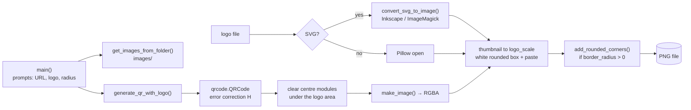

# QR Code Creator

**Branded QR codes from the command line.** Generate a QR code with your logo in the centre and optional rounded corners.

[](https://github.com/LuisEduardoGE/qr-code-creator/actions/workflows/ci.yml)
[](LICENSE)


## Table of Contents

- [Features](#features)
- [Tech Stack](#tech-stack)
- [Architecture](#architecture)
- [Quick Start](#quick-start)
- [Usage](#usage)
- [Testing](#testing)
- [Project Structure](#project-structure)
- [Tips](#tips)
- [Author](#author)
- [License](#license)

## Features

- Interactive CLI: paste a URL, pick a logo, choose a corner radius.
- Picks up every logo in `images/` (PNG, JPG, GIF, BMP, WebP, SVG).
- High error correction (level H), so the logo can cover up to ~30% of the code and it still scans. The modules under the logo are cleared and a white rounded box sits behind it.
- Optional rounded corners for the whole image (transparent outside the curve).
- Usable as a library: one function, `generate_qr_with_logo()`.

## Tech Stack

| Layer | Choice |
|---|---|
| Language | Python 3.10+ |
| QR encoding | [qrcode](https://pypi.org/project/qrcode/) 7.4+ (`qrcode[pil]`) |
| Imaging | Pillow 10+ |
| SVG logos (optional) | Inkscape or ImageMagick on `PATH` |
| Tests / lint | pytest, zxing-cpp (decoder), ruff |

## Architecture



Everything lives in [`qr_with_logo.py`](qr_with_logo.py). `main()` collects the inputs, then
`generate_qr_with_logo()` builds the QR matrix, blanks the modules that the logo will cover (error
correction H restores them when scanning), renders the image, pastes the logo on a white rounded box
and optionally rounds the outer corners before saving.

## Quick Start

Prerequisites: Python 3.10+. For SVG logos, Inkscape **or** ImageMagick; otherwise convert them to PNG first.

```bash
python -m venv .venv
source .venv/bin/activate        # Windows: .venv\Scripts\activate
make install                     # or: pip install -r requirements-dev.txt
make run                         # or: python qr_with_logo.py
```

`requirements.txt` holds the runtime dependencies only; `requirements-dev.txt` adds pytest, ruff and zxing-cpp.

## Usage

1. Put your logo files in `images/` (git-ignored; created on first run if missing).
2. Run the generator and answer the prompts:

```bash
python qr_with_logo.py
```

```
Enter the URL to encode: https://example.com
Select a logo by number (or choose 'No logo'): 1
Enter border radius (0 for square corners): 30
```

The PNG is saved in the current directory, named after the first 30 characters of the URL
(for example `qr_https___example_com.png`). The CLI uses a 2-module quiet zone and a logo at 20% of the code's width.

### As a library

```python
from qr_with_logo import generate_qr_with_logo

generate_qr_with_logo("https://example.com", "images/logo.png", "out.png", border_radius=30)
```

| Parameter | Default | Meaning |
|---|---|---|
| `data` | (required) | Text or URL to encode |
| `logo_path` | (required) | Logo image path, or `None` for a plain code |
| `output_path` | `qr_with_logo.png` | Where to save the PNG |
| `qr_box_size` | `10` | Pixels per QR module |
| `qr_border` | `4` | Quiet zone, in modules |
| `logo_scale` | `0.2` | Logo width as a fraction of the code's width |
| `border_radius` | `0` | Radius of the rounded outer corners, in pixels (0 = square) |

## Testing

```bash
make test      # pytest -q
make lint      # ruff check .
```

9 tests pass. They generate QR codes into pytest temp directories and check that:

- the PNG exists and its size matches the QR geometry (square, a whole number of modules, e.g. 370×370 px for `https://example.com` at the defaults);
- `qr_box_size` and `qr_border` change the dimensions as expected;
- the code **decodes** back to the input with [zxing-cpp](https://pypi.org/project/zxing-cpp/), with and without a logo, with rounded corners, and for a long (270-character) URL;
- the logo sits in the centre, and rounded corners are transparent;
- `get_images_from_folder()` creates a missing folder and filters and sorts by extension;
- the interactive CLI (with scripted answers) writes the file named after the URL.

CI ([`ci.yml`](.github/workflows/ci.yml)) runs `make install`, `make lint` and `make test` on every push and pull request to `main`.

## Project Structure

```
qr_with_logo.py        CLI + generate_qr_with_logo() library function
tests/                 pytest suite (generates and decodes QR codes)
docs/example.png       README example image
requirements.txt       runtime deps (qrcode[pil], Pillow)
requirements-dev.txt   adds pytest, ruff, zxing-cpp
Makefile               install / run / test / lint / clean
images/                your logos (git-ignored)
```

## Tips

- High-contrast logos scan most reliably.
- If a code scans poorly, lower `logo_scale` (default 0.2) or the corner radius.

## Author

**Luis Eduardo G. Espindola** · [GitHub](https://github.com/LuisEduardoGE) · [LinkedIn](https://www.linkedin.com/in/luisgespindola/)

## License

[MIT](LICENSE) © Luis Eduardo G. Espindola
